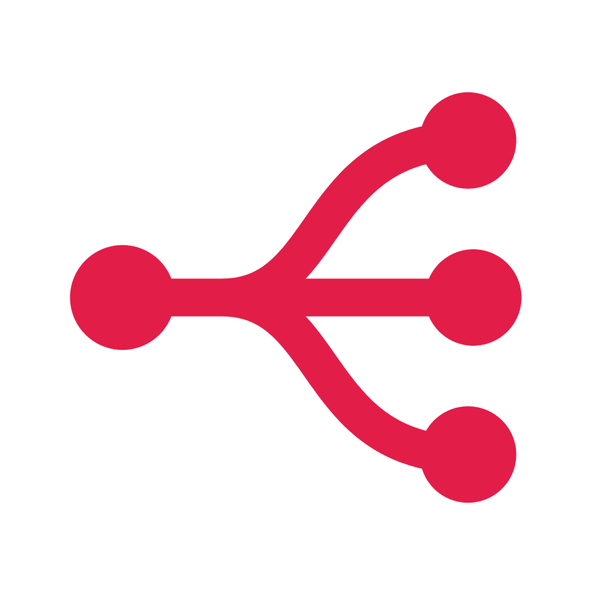

<p align="center">
  
</p>

<h1 align="center">AXON STUDIO</h1>

> Neural Synapse Workspace for Multi-Agent Coding Orchestration.

Axon is an event-driven desktop studio that replaces traditional tiling terminal emulators with a dynamic, biological neural network canvas. Designed for single-display workflows, Axon coordinates multiple specialized coding agents without idle token waste or screen overcrowding.

---

## Architecture Principles

1. **Zero-Idle Token Guarantee:** Agents consume zero tokens while in `IDLE` state. LLM APIs are invoked strictly on explicit user prompts or directed peer-to-peer delegation events.
2. **Radial Synaptic Topology:** Dynamic force-directed graph with a central Brain Hub and branching agent nodes.
3. **Floating Peek Terminal:** Clean canvas overview with on-demand pop-up terminals powered by xterm.js for auditing without clutter.
4. **Batch Operations:** Multi-select nodes to inject skills or trigger memory compaction simultaneously.
5. **Dark Theme Native:** Obsidian and cyber-slate palette optimized for long development sessions.
6. **Strict Zero-Emoji Policy:** Clean semantic labels and vector SVG icons throughout the interface and codebase.

---

## Technology Stack

- **Desktop Shell:** Tauri v2 / Rust native runtime
- **Frontend Framework:** React 19 + TypeScript + Vite
- **Styling:** Tailwind CSS v4 (Obsidian Dark Palette)
- **Canvas Engine:** @xyflow/react
- **Terminal Engine:** @xterm/xterm + @xterm/addon-fit
- **State Management:** Zustand
- **Icons:** Lucide React (pure vector SVG paths)

---

## Getting Started

### Prerequisites

- Node.js >= 20.x
- Rust >= 1.80 (for desktop Tauri builds)

### Development

```bash
# Install dependencies
npm install

# Run Vite development server (Browser Preview)
npm run dev

# Build for production
npm run build
```

The browser preview will be accessible at `http://localhost:1420`.
